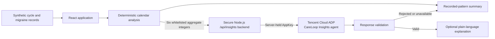

# CareLoop — Project Overview

CareLoop is a menstrual migraine self-care companion prototype for adults. It helps people organise recorded migraine episodes and menstrual-cycle history, see timing patterns across those records, and prepare clearer information for conversations with healthcare professionals.

The prototype combines transparent calendar calculations with an optional plain-language explanation from the published **CareLoop Insights** agent on Tencent Cloud ADP. CareLoop does **not** diagnose menstrual migraine, predict future attacks, prescribe treatment, or provide medication advice. Its summaries describe only the limited information recorded in the demo.

## The Problem

Migraine episodes and menstrual cycles unfold over weeks and months. Without consistent records, it can be difficult to remember exact onset dates, compare them with period starts, or explain a possible timing pattern during a short healthcare appointment.

CareLoop brings those records into one place. It presents migraine and cycle history on a shared calendar, calculates a reproducible timing summary, communicates when there is too little information for a stronger summary, and offers an optional AI explanation grounded in the same aggregate results.

## Key Features

| Area | What is implemented | Status |
| --- | --- | --- |
| **Dashboard** | Switch between three fictional demo patients; review recorded cycles, episode counts, recent attacks, days since the last attack, average recorded severity, and locally added entries. | Functional prototype |
| **Cycle Calendar** | View confirmed period starts, explicitly recorded bleeding days, and migraine onsets together. Users can add or remove period starts, record flow and optional pain severity, move between months, and see cycle lengths calculated only between confirmed starts. No cycle prediction is performed. | Functional prototype; browser-local persistence |
| **Migraine Diary** | Log an attack happening now or a past attack, including start/end time, peak severity, associated symptoms, functional impact, and notes. Entries can be filtered, edited, ended, deleted with a short undo window, or reset to the synthetic demo state. | Functional prototype; browser-local persistence |
| **AI Insights / Recorded Patterns** | Classify recorded migraine onset dates against confirmed period starts, show the deterministic counts and timeline, and optionally request a plain-language explanation from Tencent Cloud ADP. | Deterministic analysis works without AI; live generation requires an AppKey |
| **Medication Tracker** | A navigation destination and explanatory placeholder are present. Medication entry, reminders, and burden analysis are not implemented in the current React application. | Demonstration-only placeholder |
| **Doctor Preparation** | A navigation destination and explanatory placeholder are present. Appointment summaries, question builders, and exports are not implemented in the current React application. The implemented dashboard, diary, calendar, and recorded-pattern summary can still help a user organise information for a consultation. | Demonstration-only placeholder |

All people and health records bundled with the application are synthetic. User-added demo entries remain in the current browser and are kept separate by fictional patient profile.

## How the AI Works

CareLoop separates calculation from explanation:

1. **Deterministic analysis is the source of truth.** JavaScript calendar logic classifies each recorded migraine by onset date. It calculates counts and data-sufficiency levels without an LLM, network call, diagnosis, or prediction.
2. **The analysis uses a five-day perimenstrual window.** The window is days −2, −1, 1, 2, and 3 around a confirmed period start. The first day of bleeding is day 1; there is no day 0. Classification uses attack onset, not attack duration.
3. **Data sufficiency controls the wording.** Level 0 does not summarise a pattern. Level 1 provides an explicitly early, hedged summary when there is at least one complete cycle and two classifiable onsets. Level 2 provides a descriptive recorded-history summary when there are at least three complete cycles and six classifiable onsets. No level establishes a diagnosis or cause.
4. **The LLM explains; it does not calculate.** React sends the Node.js backend only six whitelisted synthetic aggregate integers: classified, in-window, outside-window and excluded onset counts, complete-cycle count, and data-sufficiency level. Names, identifiers, diary notes, symptoms, and dates are not sent to ADP.
5. **The backend protects the credential and validates the result.** The private AppKey is added only on the server. Generated text is checked for length, the required safety statement, unsupported numbers, diagnoses, causal claims, predictions, symptoms, and medication guidance. Invalid, missing, unavailable, or rate-limited AI responses leave the deterministic summary available as the safe fallback.



## Tencent Cloud Technologies and Development Tools

- **Tencent Cloud ADP** hosts the published CareLoop Insights agent used to generate optional plain-language explanations of deterministic aggregate results.
- **Tencent WorkBuddy** assisted with AI workflow specification, development and review activities, and testing of the published ADP agent through an MCP connector.

These are separate integrations. The optional WorkBuddy MCP connection supports the development and agent-testing workflow; it is not part of the React application at runtime. The application uses its own Node.js backend to call the published Tencent Cloud ADP API, keeping the AppKey out of the browser.

## Run Locally

### Prerequisites

- Node.js `^20.19.0 || >=22.12.0`. The lockfile currently installs Vite 8.3.4, so earlier Node 20 releases are not sufficient.
- npm

### Setup

1. Install dependencies:

   ```bash
   npm install
   ```

2. Copy `.env.example` to `.env`.

3. For live AI generation, set `ADP_APP_KEY` in `.env` to the private AppKey for the published CareLoop Insights agent. Never commit this value. To run without live AI, leave `ADP_APP_KEY` empty; deterministic features remain available and the interface shows its safe recorded-summary fallback if generation is requested.

4. Start the Node.js backend in one terminal:

   ```bash
   npm run server
   ```

5. Start the Vite development server in a second terminal:

   ```bash
   npm run dev
   ```

6. Open the local URL printed by Vite. Vite proxies `/api` to `127.0.0.1:8787`. With a valid AppKey, open **AI Insights** and select **Generate AI Explanation** to test the ADP connection.

The local backend logs only safe connection diagnostics: the local route, credential presence as a boolean, upstream HTTP status and content type, SSE event types, and failure category. It does not log the AppKey, prompt, aggregate facts, or complete request bodies. Set `ADP_DIAGNOSTICS=disable` to disable these development diagnostics.

## Testing, Privacy and Safety

Run the automated test suite:

```bash
npm test
```

The tests cover fixture normalisation, diary validation and local persistence, calendar arithmetic, the five-day classification window, data-sufficiency rules, client-side fact selection and fallback errors, ADP streaming and output validation, endpoint limits and authentication, and production server routing. Tencent requests are mocked in automated tests.

Verify the production frontend build:

```bash
npm run build
```

Privacy and safety boundaries:

- The bundled patient profiles, dates, health details, and histories are fictional demonstration data with a fixed historical reference date.
- The recorded history is intentionally limited. CareLoop reports missing or insufficient data instead of treating unknown values as zero or inferring information.
- The deterministic analysis describes timing association only. Neither it nor the AI explanation diagnoses a condition, establishes causation, predicts attacks, or gives medication advice.
- ADP receives only the six whitelisted aggregate integers described above. Raw diary records, free-text notes, names, identifiers, symptoms, and dates are rejected from the AI request path.
- `/api/insights` defaults to 5 requests per IP per hour, 2 simultaneous Tencent ADP calls, and 50 upstream attempts per UTC day. Configure these with `ADP_RATE_LIMIT_PER_HOUR`, `ADP_MAX_CONCURRENT`, and `ADP_DAILY_REQUEST_LIMIT`.
- An upstream attempt is reserved before Tencent is called, so failures, timeouts, and rejected model output still consume daily capacity. Invalid requests and failed authentication consume the per-IP allowance.
- `ADP_DEMO_PASSWORD` can require shared demo access. It uses HTTP Basic authentication and must be used only over HTTPS. The password is entered at runtime, held in page memory, and never included in the frontend bundle.
- Set `ADP_TRUST_PROXY=true` only when a trusted proxy is independently verified to overwrite `X-Forwarded-For`; otherwise a caller could spoof its rate-limit identity.
- Rate, concurrency, and daily counters are held in memory for a single-instance hackathon demo. They reset when the process restarts, are not shared across instances, and are not a billing boundary. Any public deployment also needs an independent Tencent Cloud request quota or spending safeguard.

## Screenshots and Demo

> **Screenshot placeholder:** Dashboard and synthetic patient overview.

> **Screenshot placeholder:** Cycle Calendar, Migraine Diary, and Recorded Patterns views.

> **Demonstration video placeholder:** A short walkthrough will be added before submission.

No public deployment is claimed by this repository.

## Optional Deployment

The project can be deployed to Render as a single **Web Service**. The Node.js process serves both the compiled Vite frontend and `/api/insights`; a separate static site or production Vite proxy is not required. If the repository contains the application in the `careloop` subdirectory, set Render's root directory to `careloop`.

- Build command: `npm ci && npm test && npm run build`
- Start command: `npm start`

`npm start` does not require a local `.env` file. Configure deployment values through Render's environment settings:

- `NODE_ENV=production`
- `ADP_APP_KEY` — private published-agent key; required for live AI generation
- `ADP_DEMO_PASSWORD` — long random demo password; strongly recommended
- `ADP_RATE_LIMIT_PER_HOUR=5`
- `ADP_MAX_CONCURRENT=2`
- `ADP_DAILY_REQUEST_LIMIT=50`
- `ADP_TRUST_PROXY=false`

Render supplies `PORT`; do not hardcode it. In production, the server uses `PORT` before `ADP_PORT` and binds to `0.0.0.0`. Locally, `npm run server` uses `ADP_PORT` (default `8787`) and binds only to `127.0.0.1`.

Keep `ADP_TRUST_PROXY=false` on Render with the current implementation. Requests will generally be keyed to Render's proxy socket, so visitors may share one conservative per-IP bucket and one visitor may temporarily throttle others. Do not enable forwarded-client identification unless the complete proxy path is verified to replace caller-supplied values.

For this demo, run one instance. Before making any deployment public, replace process-local controls with an edge or shared-store limiter based on a platform-verified client identity, protect the demo with HTTPS, and configure an independent Tencent Cloud quota or spending safeguard.
